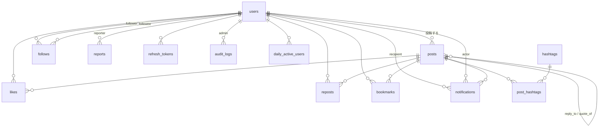

# DB スキーマ（データ辞書）

PostgreSQL の全テーブルの一覧です。**正は `packages/db/migrations/*.sql`** で、ここはその要約（読む人のための地図）です。マイグレーションを足したら、このファイルも更新してください。

型は `pnpm db:codegen` で `packages/db/src/generated/db.ts` に自動生成されます（列名は SQL と同じ snake_case）。

## ER 図

## テーブル一覧

| テーブル                          | 役割                                                           | 主なルール（DB の制約で守っているもの）                                                                                                        |
| --------------------------------- | -------------------------------------------------------------- | ---------------------------------------------------------------------------------------------------------------------------------------------- |
| `users`                           | 一般ユーザーと管理者（`role`）                                 | ハンドル（3〜15 文字の英数字と `_`）・メールは大文字小文字を区別せず一意。表示名 1〜50 文字、自己紹介 160 文字まで                             |
| `refresh_tokens`                  | ログイン維持用のトークン（**ハッシュのみ**保存）               | `token_hash` が一意。凍結・強制ログアウトで `revoked_at` を設定                                                                                |
| `posts`                           | 投稿・リプライ・引用                                           | 本文 280 文字まで、画像 4 枚まで、本文も画像も無い投稿は不可、リプライと引用の同時指定は不可。`status`（表示中 / 非表示 / 削除済み）で論理削除 |
| `hashtags` / `post_hashtags`      | ハッシュタグ（`#` を除いた小文字）と、投稿との対応             | タグは一意。日本語タグも可                                                                                                                     |
| `follows`                         | フォロー関係                                                   | `(follower_id, followee_id)` が主キー（重複不可）、自分自身は不可                                                                              |
| `likes` / `reposts` / `bookmarks` | 投稿への反応                                                   | `(user_id, post_id)` が主キー（同じ操作の重複不可）                                                                                            |
| `notifications`                   | 通知（いいね・リポスト・フォロー・リプライ・メンション・引用） | 自分宛ては不可。フォロー以外は対象の投稿が必須                                                                                                 |
| `reports`                         | ユーザーからの通報                                             | 対象は投稿かユーザーの一方のみ。同じ人の同じ対象への重複通報は不可。ステータスは `open` / `in_progress` / `resolved`                           |
| `audit_logs`                      | 管理者操作の記録                                               | **UPDATE / DELETE はトリガーで禁止**（改ざん防止）。管理者の削除は `RESTRICT`                                                                  |
| `daily_active_users`              | DAU 集計用（1 ユーザー 1 日 1 行）                             | `(active_date, user_id)` が主キー                                                                                                              |

`pgmigrations` は node-pg-migrate の管理用テーブル（アプリからは使わない）。

## インデックスと、使う場面

| 場面                                 | インデックス                                                                                |
| ------------------------------------ | ------------------------------------------------------------------------------------------- |
| フォロー中タイムライン               | `posts_author_created_idx (author_id, created_at DESC, id DESC)` + `follows_pkey`           |
| おすすめ・全体の新しい順（cursor）   | `posts_visible_created_idx (created_at DESC, id DESC) WHERE status = 'visible'`             |
| プロフィールの投稿 / リプライ一覧    | `posts_author_created_idx` / `posts_reply_to_idx`                                           |
| 投稿・ユーザー・タグの部分一致検索   | `pg_trgm` の GIN（`posts_content_trgm_idx` など）。日本語でも使える                         |
| トレンド・タグ検索                   | `post_hashtags_hashtag_created_idx (hashtag_id, created_at DESC)`                           |
| 通知一覧 / 未読バッジ                | `notifications_recipient_created_idx` / `notifications_unread_idx`（未読のみの部分 index）  |
| フォロワー・いいね・ブックマーク一覧 | `follows_followee_created_idx`、`likes_user_created_idx`、`bookmarks_user_created_idx` など |
| 管理画面の一覧                       | `users_role_suspended_created_idx`、`reports_status_created_idx`、`audit_logs_*`            |
| ダッシュボードの DAU                 | `daily_active_users_pkey`（日付範囲の検索と日ごとの集計）                                   |
| 凍結時の token 失効                  | `refresh_tokens_active_user_idx`（失効していない行だけ）                                    |

**書き方の注意**: ハンドル・メールの完全一致は `lower(handle) = lower($1)` と書く（`handle = $1` だと一意 index が使われない）。

主要クエリが上記のインデックスを使えることは、`EXPLAIN` で確認済みです（Phase 1）。データが少ないと PostgreSQL はあえて全件走査を選ぶため、確認は `SET enable_seqscan = off` で行います。**データが増えたら `EXPLAIN (ANALYZE, BUFFERS)` で再確認**してください。

## 将来の改善候補（必要になったら ADR を書いて実施）

- いいね数・フォロワー数などの **カウンタ列**（集計が重くなったら。更新の一貫性に注意）
- `posts` の **パーティション**（月単位。件数が数千万規模になったら）
- タイムライン用の **ファンアウト**（書き込み時にフォロワーのタイムラインへ展開）や Redis キャッシュ
